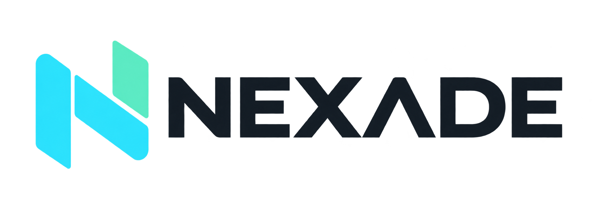
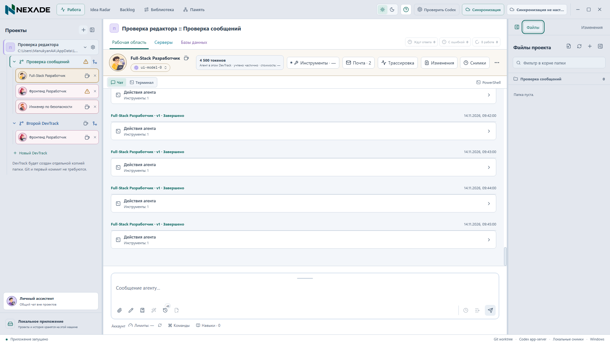

  

# NEXADE

**Ваша команда AI. Ваша рабочая среда.**

NEXADE — мультиагентная рабочая среда для тех, кто воплощает собственные идеи в код с помощью AI. Распределяйте задачи между ролями, сохраняйте контекст проекта и проверяйте изменения.

[Страница продукта](https://lastart.github.io/nexade/) · [Выпуски и установщики](https://github.com/LastArt/nexade/releases)

*Интерфейс Preview 0.5.1 в светлой теме. На снимках используются учебные данные.*

## Что можно организовать в NEXADE

| Возможность | Для чего |
| --- | --- |
| DevTrack | Отдельная рабочая папка, участники и обсуждения для задачи. |
| Роли агентов | Разбор решения, реализация, проверка и другие специализации. |
| Визуальные сценарии | Этапы AI и человека, условия переходов, навыки и ограниченные возвраты. |
| Память | Знания, заметки и решения с поиском и графом связей. |
| Навыки | Собственная библиотека NEXADE с инструкциями, ресурсами и версиями. |
| Idea Radar и Backlog | От исходных идей и сигналов к постановке и организации задач. |
| Трассировка | Ходы сессии, инструменты и сообщённые провайдером токены. |
| Базы данных | Схема, колонки, ограниченный SQL и доступ по разрешениям. |
| Серверы | Подключения, удалённый терминал, команды и файлы через SSH/SFTP. |
| Почта участников | Вопросы, ответы и цепочки сообщений в контексте проекта. |
| Снимки и синхронизация | Копии папок, восстановление в новое место и переносимое рабочее состояние. |

## Например

- Разработать новую форму по этапам: разбор → реализация → проверка человеком.
- Проверить, сохраняется ли запись в тестовую базу, и сопоставить результат с интерфейсом.
- Сохранить причины архитектурного решения и вернуться к ним при следующем изменении.
- Разобраться в журнале тестового сервера через разрешённое подключение.
- Продолжить проект на другом компьютере после синхронизации переносимых данных.
- Восстановить снимок отдельно и сравнить эксперимент с прежним вариантом.

## Каталог ролей и авторство

В библиотеку включены **33 специализированные роли NEXADE** и **283 роли проекта [agency-agents](https://github.com/msitarzewski/agency-agents)**.

Источник расширенного каталога: msitarzewski/agency-agents, включённая редакция 8ae6164602c95ca78828b148b9052460ee426885. Этот сторонний каталог распространяется по лицензии MIT; в включённой лицензии указан copyright © 2025 AgentLand Contributors. Сведения о лицензии каталога не задают лицензию всего приложения NEXADE.

Роли — определения специализаций и инструкций. Их количество не означает одновременное выполнение всех агентов.

## Установка и новые версии

Установщики, изменения и сведения о конкретном выпуске размещаются в разделе [Releases](https://github.com/LastArt/nexade/releases).

Для Windows выбирайте файл NEXADE-Setup с расширением .exe. Автоматические архивы Source code на GitHub содержат дерево этого публичного репозитория — файлы сайта и README. Исходники приложения сюда не включаются.

Текущий описанный контур Preview: **Windows 10/11 x64**. Для работы с AI нужны интернет и настроенный доступ к провайдеру. Совместимость Preview 0.5.1: Codex.

Модуль автоматических обновлений и условный расчёт денежной стоимости находятся в разработке. Пока новую версию устанавливают вручную. Токены показываются при наличии данных провайдера; они не являются фактическим денежным списанием.

## Границы текущего Preview

- Результат работы агента требует проверки; завершение запуска не означает приёмку изменений.
- Работа с памятью, инструментами, серверами и базами зависит от разрешений.
- Сценарии исполняются последовательно; возвраты ограничены настройками.
- Память и почта агентов пока локальные. Авторизация и внутренние сеансы AI не переносятся синхронизацией.
- Локальные снимки не зашифрованы и могут содержать секреты проекта. Восстановление файлов не откатывает внешние сервисы и процессы.
- При обращении к AI необходимый контекст передаётся провайдеру.

## Что хранится в этом репозитории

Здесь размещаются публичная страница продукта, её изображения, это описание и выпуски приложения. Исходники приложения и конфигурация его сборки находятся в отдельном приватном репозитории.
